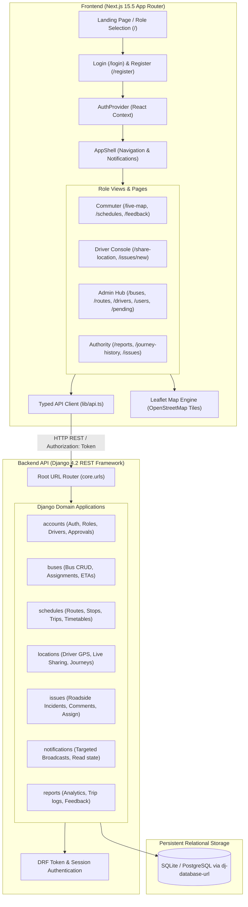
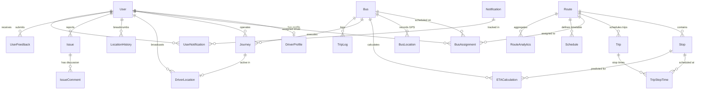
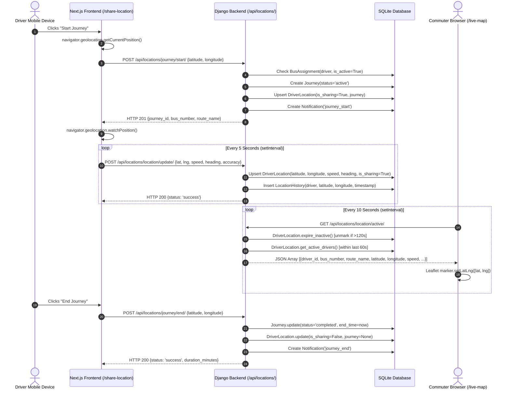

# UBus — Comprehensive Technical Audit & Architectural Reconnaissance Report

**Document Date:** November 19, 2026  
**Audit Target:** UBus — University Bus Tracking & Management System  
**Audited Directory:** `D:\Projects\Bus-tracking`  
**Current Git Branch:** `hij_dev`  
**Auditor:** Senior Software Architect, Full-Stack Engineer & Technical Documentation Specialist  
**Execution Type:** Strictly Read-Only Forensic Audit & Architectural Assessment  

---

## 1. Executive Summary

**UBus** is a full-stack, role-governed university transit management and live bus tracking platform. It is architecturally decoupled into:
1. **Backend:** Pure Python (3.11/3.12 compatible), Django 4.2+, Django REST Framework 3.14+, Token Authentication, WhiteNoise, and SQLite (with optional PostgreSQL support via `dj-database-url`).
2. **Frontend:** Next.js 15.5.29 (App Router, Turbopack), React 19.1.0, TypeScript 5, Tailwind CSS v4, Lucide React icons, and raw Leaflet 1.9.4.

The project implements a complete multi-role ecosystem supporting six distinct user roles: **Fleet Administrator (`admin`)**, **University Authority (`authority`)**, **Bus Driver (`driver`)**, **Student (`student`)**, **Faculty (`faculty`)**, and **Staff (`staff`)**.

### Current Maturity Level
- **Core Architecture & UI Structure:** **80% Complete.** Modern App Router with responsive layouts, role-based navigation, interactive Leaflet maps, dynamic Route Builder forms, and tabbed analytics reports.
- **Backend API Endpoints:** **85% Complete.** 40+ REST API endpoints implemented across seven Django domain applications (`accounts`, `buses`, `schedules`, `locations`, `issues`, `notifications`, `reports`).
- **End-to-End Real-Time GPS Tracking Integration:** **65% Complete.** Live location broadcasting from mobile browser (`navigator.geolocation.watchPosition` polled every 5s) and live map consumption (`setInterval` every 10s) work via the `locations` app. However, an architectural disconnect exists between driver GPS broadcasts (`DriverLocation`) and vehicle tracking (`BusLocation`), leaving vehicle follow-modes and automated ETA recalculation disconnected.
- **Testing & Quality Assurance:** **0% Complete.** There is literally **zero test coverage** across the entire project (no unit tests, integration tests, or API tests exist in backend or frontend).
- **Background Workers & Automation:** **20% Complete.** No background job runner (Celery, Redis, Django-Q) is installed. Aggregations (e.g. `RouteAnalytics`, `TripLog`) lack automated cron/worker pipelines and remain unpopulated.

---

## 2. Project Identity & Current Status

- **System Name:** UBus (University Bus Tracking & Management System)
- **Primary Domain:** University campus and inter-city commuter transit fleet monitoring
- **Repository Structure:** Decoupled monorepo (`backend/` and `frontend/`)
- **Git Branch Baseline:** `hij_dev` (tracking `origin/hij_dev`, checkpoint commit `b3cef44`)
- **Application Status:** Development / Pre-Production. Both frontend and backend can be booted locally without compilation failure, but critical runtime disconnects and absent background task workers prevent production readiness.

---

## 3. Verified Technology Stack

### Backend Stack
| Technology / Package | Verified Version | Evidence File | Purpose / Role |
|---|---|---|---|
| Python | 3.11+ / 3.12 | `.venv\pyvenv.cfg` | Runtime environment |
| Django | `>=4.2.0,<5.0` | `backend/requirements.txt#L2` | Core Web & ORM Framework |
| Django REST Framework | `>=3.14.0` | `backend/requirements.txt#L3` | RESTful API Serialization & Controllers |
| django-cors-headers | `>=4.3.0` | `backend/requirements.txt#L4` | Cross-Origin Resource Sharing control |
| Pillow | `>=10.0.0` | `backend/requirements.txt#L5` | Image upload handling (Profile pictures) |
| dj-database-url | `>=1.0.0` | `backend/requirements.txt#L10` | Database URL parser for production databases |
| WhiteNoise | `>=6.6.0` | `backend/requirements.txt#L26` | Static file compression and serving |
| Gunicorn | `>=21.2.0` | `backend/requirements.txt#L25` | Production WSGI HTTP server |
| python-dotenv | `>=1.0.0` | `backend/requirements.txt#L27` | Environment variable management |
| Cloudinary (optional) | `>=1.38.0` | `backend/requirements.txt#L30` | Cloud media storage adapter |
| Database Engine | SQLite 3 (`db.sqlite3`) | `backend/core/settings.py#L76` | Relational storage (dev default) |

### Frontend Stack
| Technology / Package | Verified Version | Evidence File | Purpose / Role |
|---|---|---|---|
| Next.js | `15.5.29` | `frontend/package.json#L14` | React Full-Stack Framework (App Router, Turbopack) |
| React | `19.1.0` | `frontend/package.json#L15` | Core UI View Library |
| React DOM | `19.1.0` | `frontend/package.json#L16` | DOM Rendering Engine |
| TypeScript | `^5` | `frontend/package.json#L28` | Static Typing & Type Safety |
| Tailwind CSS | `^4` (via `@tailwindcss/postcss`) | `frontend/package.json#L27` | Utility-first styling framework |
| Leaflet | `^1.9.4` | `frontend/package.json#L12` | Interactive Web Mapping Engine (OpenStreetMap) |
| Lucide React | `^1.75.0` | `frontend/package.json#L13` | SVG Icons library |
| API Communication | Native Browser `fetch` | `frontend/src/lib/api.ts#L68` | HTTP Client (custom `apiFetch` wrapper) |
| State Management | React Context (`AuthProvider`) | `frontend/src/components/AuthProvider.tsx` | Global authentication and session state |

---

## 4. Repository Structure

```text
D:\Projects\Bus-tracking/
├── .gitignore
├── README.md
├── UBUS_TECHNICAL_AUDIT.md             # [This Audit Report]
├── backend/
│   ├── .env                           # Local environment config
│   ├── .env.example                   # Baseline template config
│   ├── db.sqlite3                     # SQLite Database (active runtime DB)
│   ├── manage.py                      # Django CLI runner
│   ├── requirements.txt               # Python package manifest
│   ├── Procfile                       # Production web dyno start command
│   ├── render-build.sh                # Render deployment script
│   ├── seed_data.py                   # Initial transit mock database seeder
│   ├── check_superusers.py            # Debug script for admin accounts
│   ├── fix_superusers.py              # Superuser password recovery utility
│   ├── core/                          # Settings, WSGI/ASGI, global routes
│   │   ├── settings.py
│   │   ├── urls.py
│   │   ├── wsgi.py
│   │   └── asgi.py
│   ├── accounts/                      # Auth, User model, Drivers, Approvals, Feedback
│   │   ├── models.py
│   │   ├── models_feedback.py
│   │   ├── serializers.py
│   │   ├── api_views.py
│   │   ├── api_urls.py
│   │   ├── admin.py
│   │   └── management/commands/create_default_users.py
│   ├── buses/                         # Fleet CRUD, Assignments, ETAs, Journeys
│   │   ├── models.py
│   │   ├── serializers.py
│   │   ├── api_views.py
│   │   ├── api_urls.py
│   │   └── admin.py
│   ├── schedules/                     # Routes, Stops, Schedules, Trips
│   │   ├── models.py
│   │   ├── serializers.py
│   │   ├── api_views.py
│   │   ├── api_urls.py
│   │   └── admin.py
│   ├── locations/                     # Driver GPS tracking, Live sharing, Journey paths
│   │   ├── models.py
│   │   ├── serializers.py
│   │   ├── api_views.py
│   │   ├── api_urls.py
│   │   └── admin.py
│   ├── issues/                        # Breakdown/Traffic Issue reports & comments
│   │   ├── models.py
│   │   ├── serializers.py
│   │   ├── api_views.py
│   │   ├── api_urls.py
│   │   └── admin.py
│   ├── notifications/                 # System alerts, route announcements, unread tracking
│   │   ├── models.py
│   │   ├── serializers.py
│   │   ├── api_views.py
│   │   ├── api_urls.py
│   │   └── admin.py
│   └── reports/                       # Analytics, Punctuality, Incident summaries
│       ├── models.py
│       ├── serializers.py
│       ├── api_views.py
│       ├── api_urls.py
│       └── admin.py
└── frontend/
    ├── package.json
    ├── package-lock.json
    ├── tsconfig.json
    ├── next.config.ts
    ├── postcss.config.mjs
    ├── eslint.config.mjs
    ├── .env.local                     # NEXT_PUBLIC_API_URL
    ├── public/
    └── src/
        ├── app/
        │   ├── layout.tsx             # Root layout with AuthProvider & metadata
        │   ├── page.tsx               # Role selection landing page
        │   ├── login/page.tsx         # Unified login portal with quick demo pills
        │   ├── register/page.tsx      # Student/Staff registration form
        │   ├── contributors/page.tsx  # Contributor recognition page
        │   ├── not-found.tsx          # Custom 404 handler
        │   └── (protected)/           # Route group guarded by session check
        │       ├── layout.tsx         # Auth guard & AppShell wrapping
        │       ├── dashboard/page.tsx # Role-specific dashboard hub
        │       ├── live-map/page.tsx  # Interactive live bus tracking map
        │       ├── routes/            # Route catalogue, detail, creation, editing
        │       ├── schedules/         # Grouped and daily departure timetables
        │       ├── buses/             # Fleet inventory, assignments, bus follow
        │       ├── drivers/           # Driver staff management (Admin/Authority)
        │       ├── share-location/    # Driver live GPS broadcast console
        │       ├── journey-history/   # Historical driver trip log and path viewer
        │       ├── issues/            # Issue submission, assignment & resolution
        │       ├── notifications/     # Targeted announcements & dismissals
        │       ├── reports/           # Fleet performance analytics & data export
        │       ├── feedback/          # Commuter service quality rating submission
        │       ├── pending/           # User registration moderation queue
        │       ├── profile/           # User profile picture & contact editor
        │       └── users/             # Comprehensive user directory & management
        ├── components/
        │   ├── AppShell.tsx           # Sidebar, Navbar, Notifications bell, User menu
        │   ├── AuthProvider.tsx       # Authentication Context & Token management
        │   ├── RouteBuilderForm.tsx   # Visual builder for Shuttle/Metro/Long routes
        │   └── maps/                  # Client-side dynamic Leaflet map visualizers
        │       ├── LiveMapView.tsx
        │       ├── BusFollowMapView.tsx
        │       ├── JourneyPathMapView.tsx
        │       ├── MiniLocationMap.tsx
        │       └── RouteMapView.tsx
        └── lib/
            ├── api.ts                 # Typed fetch client, token management, ApiError
            └── types.ts               # Shared TypeScript domain models & interfaces
```

---

## 5. Architecture Overview

### A. High-Level Architecture Diagram



### B. Request & Data Flow
1. **Authentication Token Attachment:** When a user logs in, DRF returns a hex token string (`Token.objects.get_or_create(user)`). The token is saved in browser `localStorage` under keys `ubus_auth_token` and `token`. All subsequent calls through `apiFetch` in `frontend/src/lib/api.ts#L57` inject `Authorization: Token <key>`.
2. **Permission Verification:** Backend view handlers enforce `@permission_classes([IsAuthenticated])` and inspect `request.user.role` or helper properties (`is_admin_user`, `is_driver`, `is_authority`). Unauthorized requests return HTTP 403 Forbidden.
3. **Response Envelope:** Most endpoints return raw JSON arrays or objects directly serialized by DRF ModelSerializers. If validation fails, standard serializer error dictionaries (`{"field": ["message"]}`) or `{"error": "message"}` are returned, parsed cleanly by `apiFetch`.

---

## 6. Backend — Complete Audit

### 6.1 `accounts` App
- **Purpose:** User lifecycle, identity, authentication, driver profiles, pending registration approvals, and authority feedback.
- **Key Models:**
  - `User` (`AbstractUser`): Custom user model with `role` (`student`, `faculty`, `staff`, `driver`, `admin`, `authority`), `approval_status` (`pending`, `approved`, `rejected`), `university_id`, `nid_number`, `phone`, `address`, `profile_picture`.
  - `DriverProfile`: OneToOne with `User`. Stores `license_number`, `license_expiry`, `emergency_contact`, `years_experience`, `is_available`, shift hours.
  - `Feedback`: In `accounts/models_feedback.py`. Stores high-level feedback messages from Authority to Admin.
- **Signals:** `post_migrate` receiver in `accounts/models.py#L6` automatically generates default admin and authority accounts if environment variables are provided.
- **Management Commands:** `create_default_users.py` provision superuser and authority from environment variables.
- **Admin Configuration:** `accounts/admin.py` registers `User`, `DriverProfile`, and `Feedback`. Note: `UserAdmin` omits `approval_status` and `university_id` from default fieldsets.

### 6.2 `buses` App
- **Purpose:** Fleet catalog, vehicle metadata, shift assignments, and vehicle-level location/ETA tracking.
- **Key Models:**
  - `Bus`: Unique `bus_number`, `license_plate`, `bus_type` (`long`, `shuttle`), `capacity`, `is_active`, `current_route` (FK `schedules.Route`), `current_trip` (FK `schedules.Trip`).
  - `BusAssignment`: Active assignment binding a `Bus`, `driver` (`User`), and `route` (`Route`). Contains strict validation in `clean()`: prevents double-booking a bus, double-assigning a driver, or assigning multiple drivers to the same route simultaneously.
  - `BusLocation`: Historical coordinates (`latitude`, `longitude`, `speed`, `heading`, `timestamp`) tied directly to a `Bus`.
  - `ETACalculation`: Stop-level ETA calculations based on Haversine distance, speed, and time buffers.
  - `Journey`: Driver trip session (`driver`, `bus`, `route`, `status` in `['active', 'completed', 'aborted']`, `start_time`, `end_time`, `start_latitude`, `start_longitude`, `end_latitude`, `end_longitude`). Note: Defined in `buses/models.py#L191` but referenced primarily by the `locations` app.
- **Admin Configuration:** Registers `Bus`, `BusLocation`, `BusAssignment`, and `ETACalculation`. Does **not** register `Journey`.

### 6.3 `schedules` App
- **Purpose:** Route builder, stop definitions, master schedules, and trip timetables.
- **Key Models:**
  - `Route`: `name`, `route_type` (`shuttle`, `metro`, `long`), `color`, `is_active`, `is_published`, `total_distance_km`, `estimated_duration_mins`, `service_days` (`sat-thu`, `sun-thu`, `mon-fri`, `all`, `custom`), `origin_name`, `destination_name`.
  - `Stop`: Individual stop coordinates on a route, with `order`, `scheduled_time`, `average_wait_time`, `is_major_stop`. Constraint: `unique_together = ['route', 'order']`.
  - `Schedule`: Weekly master recurring timetable linking `route`, `bus`, `driver`, `day_of_week` (`mon`..`sun`), `departure_time`, `arrival_time`.
  - `StopSchedule`: Stop arrival/departure timetable within a master schedule.
  - `ScheduleException`: Holiday/cancellation overrides for specific dates.
  - `Trip`: Specific trip runs for Shuttle/Metro routes (e.g., "Trip 01", "Trip 02") with departure and arrival times.
  - `TripStopTime`: Stop timetable for a specific trip.
  - `LiveETA`: Abandoned duplicate ETA model.
- **Admin Configuration:** Registers `Route`, `Stop`, `Schedule`, `StopSchedule`, and `ScheduleException`. Does **not** register `Trip` or `TripStopTime`.

### 6.4 `locations` App
- **Purpose:** Real-time driver GPS tracking, active journey management, and GPS breadcrumb path recording.
- **Key Models:**
  - `DriverLocation`: OneToOne with driver `User`. Stores `latitude`, `longitude`, `accuracy`, `heading`, `speed`, `is_sharing`, `last_updated`, `session_started`, and FK to `buses.Journey`. Contains helper method `expire_inactive()` to automatically unmark stale drivers (inactive > 120s).
  - `LocationHistory`: GPS breadcrumb log (`driver`, `latitude`, `longitude`, `timestamp`) used for historical journey path replay.
- **Admin Configuration:** Registers `DriverLocation` and `LocationHistory`.

### 6.5 `issues` App
- **Purpose:** Roadside breakdown and delay reporting, driver incident tickets, comments, and resolution workflows.
- **Key Models:**
  - `Issue`: `issue_type` (`mechanical`, `traffic`, `emergency`, `accident`, `weather`, `other`), `reported_by`, `bus`, `route`, `latitude`, `longitude`, `status` (`pending`, `in_progress`, `resolved`, `cancelled`), `priority` (`low`, `medium`, `high`, `critical`), `assigned_to`, `resolution_notes`.
  - `IssueComment`: Discussion thread on an issue.
  - `IssueAttachment`: File attachment storage for evidence.
- **Admin Configuration:** Registers `Issue`, `IssueComment`, `IssueAttachment`.

### 6.6 `notifications` App
- **Purpose:** System-wide broadcast alerts, emergency notices, driver delay alerts, and per-user read/dismiss state tracking.
- **Key Models:**
  - `Notification`: `title`, `message`, `notification_type` (`announcement`, `delay`, `journey_start`, `journey_end`, `emergency`, `issue`), `priority` (`info`, `warning`, `danger`, `success`), `source`, `target` (`all`, `users`, `drivers`, `route`, `admin`, `authority`, `admin_authority`), `target_route`, `created_by`, `related_bus`, `related_journey`, `is_active`, `expires_at`.
  - `UserNotification`: Join table tracking whether a specific user has read or dismissed a notification. Constraint: `unique_together = ['notification', 'user']`.
- **Admin Configuration:** Registers `Notification` and `UserNotification`.

### 6.7 `reports` App
- **Purpose:** Transit reporting, punctuality aggregation, feedback collection, and performance analytics.
- **Key Models:**
  - `TripLog`: Daily trip completion log with scheduled vs actual departure/arrival and passenger counts.
  - `UserFeedback`: Rating (1-5 stars), `category` (`service`, `timing`, `cleanliness`, `driver`, `app`, `other`), `comment`, `is_anonymous`, `is_resolved`, `admin_response`.
  - `RouteAnalytics`: Daily aggregated route stats (`total_trips`, `on_time_trips`, `delayed_trips`, `total_passengers`, `average_delay_mins`, `issues_count`). Constraint: `unique_together = ['route', 'date']`.
- **Admin Configuration:** Registers `TripLog`, `UserFeedback`, `RouteAnalytics`.

---

## 7. Database & ER Diagram



### Database Integrity Concerns
1. **Model Duality & Orphaned GPS:** `buses.BusLocation` and `locations.DriverLocation` track overlapping data. Driver uploads populate `DriverLocation` and `LocationHistory`, leaving `buses.BusLocation` unpopulated.
2. **Abandoned Model:** `schedules.LiveETA` is completely unused and orphaned.
3. **Missing Automated Pipelines:** `reports.RouteAnalytics` and `reports.TripLog` are never written to by business logic.

---

## 8. Complete API Endpoint Inventory

| Method | Endpoint | Purpose | Auth Required | Permissions | Controller / View |
|---|---|---|---|---|---|
| `GET` | `/` | API Root Discovery | No | AllowAny | `core.urls.api_root` |
| **Auth & Accounts** | | | | | |
| `POST` | `/api/auth/login/` | User login (returns Token & user profile) | No | AllowAny | `accounts.api_views.login_api` |
| `POST` | `/api/auth/register/` | Commuter registration (sets pass=UnivID, status=pending) | No | AllowAny | `accounts.api_views.register_api` |
| `POST` | `/api/auth/logout/` | Revoke DRF auth token | Yes | IsAuthenticated | `accounts.api_views.logout_api` |
| `GET` | `/api/auth/me/` | Current user profile & pending badge count | Yes | IsAuthenticated | `accounts.api_views.me_api` |
| `GET/PATCH/PUT`| `/api/auth/profile/` | Inspect and edit contact details & profile picture | Yes | IsAuthenticated | `accounts.api_views.profile_api` |
| `GET` | `/api/auth/dashboard/` | Role-tailored dashboard statistics & summaries | Yes | IsAuthenticated | `accounts.api_views.dashboard_api` |
| `GET/POST` | `/api/auth/users/` | List users (Admin/Authority) or create user (Admin) | Yes | Admin/Authority | `accounts.api_views.user_list_create_api` |
| `GET/PATCH/PUT/DELETE`| `/api/auth/users/<id>/` | View, update, or remove user account | Yes | Admin only | `accounts.api_views.user_detail_api` |
| `GET` | `/api/auth/pending/` | List pending registrations | Yes | Admin only | `accounts.api_views.pending_registrations_api` |
| `POST` | `/api/auth/pending/<id>/approve/`| Approve user account & activate | Yes | Admin only | `accounts.api_views.approve_user_api` |
| `POST` | `/api/auth/pending/<id>/reject/` | Reject user account with reason | Yes | Admin only | `accounts.api_views.reject_user_api` |
| `GET/POST` | `/api/auth/drivers/` | List drivers (Admin/Authority) or register driver (Admin) | Yes | Admin/Authority | `accounts.api_views.driver_list_create_api` |
| `GET/PATCH/PUT/DELETE`| `/api/auth/drivers/<id>/`| Inspect, update credentials, or delete driver | Yes | Admin only | `accounts.api_views.driver_detail_api` |
| `GET/POST` | `/api/auth/authority-feedback/` | Submit (Authority) or list feedback (Admin/Authority) | Yes | Authority / Admin | `accounts.api_views.authority_feedback_api` |
| **Buses & Fleet** | | | | | |
| `GET/POST` | `/api/buses/` | List fleet buses or add new bus (Admin) | Yes | IsAuthenticated / Admin | `buses.api_views.bus_list_create_api` |
| `GET/PATCH/PUT/DELETE`| `/api/buses/<id>/` | Inspect bus, recent locations/shifts, or modify bus | Yes | IsAuthenticated / Admin | `buses.api_views.bus_detail_api` |
| `GET` | `/api/buses/locations/` | Active bus locations formatted for map markers | Yes | IsAuthenticated | `buses.api_views.bus_locations` |
| `GET` | `/api/buses/etas/` | Latest stop-level ETAs and delay minutes | Yes | IsAuthenticated | `buses.api_views.bus_etas_api` |
| `POST` | `/api/buses/update-location/` | Legacy/alternative bus location update | Yes | Driver only | `buses.api_views.update_location` |
| `POST` | `/api/buses/stop-tracking/` | Deactivate driver's current bus assignment | Yes | Driver only | `buses.api_views.stop_tracking` |
| `GET` | `/api/buses/assignments/options/`| Get unassigned buses, drivers, and routes | Yes | Admin only | `buses.api_views.assignment_options_api` |
| `GET/POST` | `/api/buses/assignments/` | List assignments or create new active assignment | Yes | Admin/Authority | `buses.api_views.assignment_list_create_api` |
| `POST` | `/api/buses/<id>/clear-assignment/`| Clear active shift assignment for a bus | Yes | Admin only | `buses.api_views.assignment_clear_api` |
| `GET` | `/api/buses/<bus_id>/eta/<stop_id>/`| Calculate point-to-point ETA to stop | Yes | IsAuthenticated | `buses.api_views.bus_eta` |
| **Routes & Schedules** | | | | | |
| `GET/POST` | `/api/schedules/routes/` | List routes (filters: type, active, search) or build route | Yes | IsAuthenticated / Admin | `schedules.api_views.route_list_api` |
| `GET/PATCH/PUT/DELETE`| `/api/schedules/routes/<id>/`| Retrieve route with stops/trips, update, or delete | Yes | IsAuthenticated / Admin | `schedules.api_views.route_detail_api` |
| `POST` | `/api/schedules/routes/<id>/publish/`| Make route visible to commuters | Yes | Admin only | `schedules.api_views.publish_route_api` |
| `POST` | `/api/schedules/routes/<id>/unpublish/`| Hide route from commuters | Yes | Admin only | `schedules.api_views.unpublish_route_api` |
| `GET/POST` | `/api/schedules/routes/<id>/stops/` | List or append stops to route | Yes | IsAuthenticated / Admin | `schedules.api_views.route_stops_api` |
| `GET` | `/api/schedules/routes/<id>/eta/` | Route stop sequence with live ETA & delays | Yes | IsAuthenticated | `schedules.api_views.route_with_eta_api` |
| `GET/POST` | `/api/schedules/routes/<id>/trips/` | List or create trips for shuttle/metro | Yes | IsAuthenticated / Admin | `schedules.api_views.route_trips_api` |
| `PATCH/PUT/DELETE`| `/api/schedules/stops/<id>/` | Modify or delete a stop | Yes | Admin only | `schedules.api_views.stop_detail_api` |
| `GET/PATCH/PUT/DELETE`| `/api/schedules/trips/<id>/` | Inspect, update, or remove a trip | Yes | IsAuthenticated / Admin | `schedules.api_views.trip_detail_api` |
| `POST` | `/api/schedules/trips/<id>/stops/` | Add a stop timetable entry to a trip | Yes | Admin only | `schedules.api_views.trip_stop_add_api` |
| `DELETE`| `/api/schedules/trip-stops/<id>/` | Delete a stop timetable entry from a trip | Yes | Admin only | `schedules.api_views.trip_stop_delete_api` |
| `GET` | `/api/schedules/grouped/` | Published routes grouped by shuttle, metro, long | Yes | IsAuthenticated | `schedules.api_views.grouped_schedules_api` |
| `GET` | `/api/schedules/today/` | Today's active departures | Yes | IsAuthenticated | `schedules.api_views.today_schedules_api` |
| `GET/POST` | `/api/schedules/` | List schedule timetables or create schedule | Yes | IsAuthenticated / Admin | `schedules.api_views.schedule_list_api` |
| `GET/PATCH/PUT/DELETE`| `/api/schedules/<id>/` | Inspect, update, or delete timetable record | Yes | IsAuthenticated / Admin | `schedules.api_views.schedule_detail_api` |
| **Locations & Tracking** | | | | | |
| `POST` | `/api/locations/journey/start/` | Start driver journey & enable GPS sharing | Yes | Driver only | `locations.api_views.start_journey` |
| `POST` | `/api/locations/journey/end/` | End active journey & disable GPS sharing | Yes | Driver only | `locations.api_views.end_journey` |
| `POST` | `/api/locations/journey/delay/` | Broadcast delay alert to commuters & admin | Yes | Driver only | `locations.api_views.report_delay` |
| `GET` | `/api/locations/journeys/` | List historical driver journeys | Yes | Admin/Authority | `locations.api_views.get_journey_history` |
| `GET` | `/api/locations/journey/<id>/path/`| Full GPS breadcrumb coordinate trail | Yes | Admin/Authority | `locations.api_views.get_journey_path` |
| `POST` | `/api/locations/location/update/` | Periodic GPS broadcast from driver device | Yes | Driver only | `locations.api_views.update_location` |
| `GET` | `/api/locations/location/active/` | List all active bus/driver GPS markers | Yes | IsAuthenticated | `locations.api_views.get_active_locations` |
| `GET` | `/api/locations/location/status/` | Driver journey & sharing status check | Yes | Driver only | `locations.api_views.get_my_location_status` |
| **Issues** | | | | | |
| `GET` | `/api/issues/` | List issues (scoped by user role) | Yes | Driver / Admin / Authority | `issues.api_views.issue_list_api` |
| `POST` | `/api/issues/create/` | Report a breakdown or traffic incident | Yes | Driver only | `issues.api_views.issue_create_api` |
| `GET` | `/api/issues/<id>/` | Inspect issue details and discussion thread | Yes | Driver / Admin / Authority | `issues.api_views.issue_detail_api` |
| `PATCH/PUT`| `/api/issues/<id>/update/` | Update issue status, priority, resolution notes | Yes | Admin/Authority | `issues.api_views.issue_update_api` |
| `POST` | `/api/issues/<id>/comments/` | Add comment to issue thread | Yes | Driver / Admin / Authority | `issues.api_views.issue_comment_api` |
| `POST` | `/api/issues/<id>/assign/` | Assign issue to administrator | Yes | Admin only | `issues.api_views.issue_assign_api` |
| `POST` | `/api/issues/<id>/resolve/` | Mark issue resolved with resolution notes | Yes | Admin/Authority | `issues.api_views.issue_resolve_api` |
| **Notifications** | | | | | |
| `GET/POST` | `/api/notifications/` | List notifications or broadcast alert (Admin) | Yes | IsAuthenticated / Admin | `notifications.api_views.notification_list_api` |
| `GET` | `/api/notifications/unread/` | Current user's unread notification items | Yes | IsAuthenticated | `notifications.api_views.unread_notifications_api` |
| `GET` | `/api/notifications/unread-count/`| Badge count of unread notifications | Yes | IsAuthenticated | `notifications.api_views.unread_count_api` |
| `POST` | `/api/notifications/read-all/` | Mark all notifications read | Yes | IsAuthenticated | `notifications.api_views.mark_all_read_api` |
| `GET/PATCH/PUT/DELETE`| `/api/notifications/<id>/`| Inspect, edit, or delete announcement | Yes | IsAuthenticated / Admin | `notifications.api_views.notification_detail_api` |
| `POST` | `/api/notifications/<id>/dismiss/`| Dismiss / acknowledge alert | Yes | IsAuthenticated | `notifications.api_views.dismiss_notification_api` |
| **Reports & Analytics** | | | | | |
| `GET` | `/api/reports/overview/` | Fleet metrics, active issues, 30d trip counts | Yes | Admin/Authority | `reports.api_views.reports_overview_api` |
| `GET` | `/api/reports/analytics/` | Route popularity, total passengers, delays | Yes | Admin/Authority | `reports.api_views.route_analytics_api` |
| `GET` | `/api/reports/performance/` | Punctuality breakdown by route & daily trends | Yes | Admin/Authority | `reports.api_views.performance_summary_api` |
| `GET` | `/api/reports/driver-incidents/`| Breakdown of issues by type and driver | Yes | Admin/Authority | `reports.api_views.driver_incidents_api` |
| `GET` | `/api/reports/driver-logs/` | Driver shift assignments and issue counts | Yes | Admin/Authority | `reports.api_views.driver_logs_api` |
| `GET` | `/api/reports/feedback-summary/`| Commuter ratings & authority messages | Yes | Admin/Authority | `reports.api_views.feedback_summary_api` |
| `POST` | `/api/reports/feedback/submit/` | Commuters submit service rating & comments | Yes | IsAuthenticated | `reports.api_views.submit_feedback_api` |
| `GET` | `/api/reports/export/` | Download raw CSV/JSON report data | Yes | Admin/Authority | `reports.api_views.export_data_api` |

---

## 9. Authentication, Roles & Permissions

### Role Permission Matrix
| Capability | Admin | Authority | Driver | Student / Faculty / Staff |
|---|:---:|:---:|:---:|:---:|
| View Live Map & Schedules | ✅ | ✅ | ✅ | ✅ |
| Submit Service Feedback | ❌ | ❌ | ✅ | ✅ |
| Broadcast Live GPS Location | ❌ | ❌ | ✅ | ❌ |
| Start / End Journey | ❌ | ❌ | ✅ | ❌ |
| Report Delay / Road Breakdown | ❌ | ❌ | ✅ | ❌ |
| Create Bus / Edit Fleet | ✅ | ❌ | ❌ | ❌ |
| Assign Bus & Driver Shifts | ✅ | ❌ | ❌ | ❌ |
| Route Builder (Create/Edit Routes) | ✅ | ❌ | ❌ | ❌ |
| Approve Commuter Registrations | ✅ | ❌ | ❌ | ❌ |
| Manage User Accounts | ✅ | ❌ | ❌ | ❌ |
| View System Reports & Analytics | ✅ | ✅ | ❌ | ❌ |
| View Historical GPS Paths | ✅ | ✅ | ❌ | ❌ |
| Submit Authority Feedback | ❌ | ✅ | ❌ | ❌ |

### Security Evaluation & Vulnerabilities
1. **Password Equals University ID:** `accounts/serializers.py#L79` sets the initial password equal to the `university_id`. This means anyone who knows a student's ID can log in unless changed.
2. **Missing Rate Limiting:** Login (`/api/auth/login/`) and GPS broadcast (`/api/locations/location/update/`) endpoints have no rate-limiting or throttling classes configured (`DEFAULT_THROTTLE_CLASSES` is absent from `REST_FRAMEWORK` settings).
3. **Hardcoded Fallback Secret Key:** `backend/core/settings.py#L10` contains a fallback secret key (`'django-insecure-change-this-in-production-key-12345'`).
4. **Weak Driver Authentication on GPS Updates:** GPS updates only check that `request.user.role == 'driver'`. If a driver has an active journey, any client authenticated with that driver's token can inject arbitrary coordinates.

---

## 10. Frontend — Complete Audit

### Application Routes & Pages
| Path | Purpose | Role Guard | Key Components / API Calls | Status |
|---|---|---|---|---|
| `/` | Role Selection Landing Page | Public | Role cards, quick demo links | ✅ Verified |
| `/login` | Authentication Portal | Public | `LoginForm`, demo pill autofill, `/api/auth/login/` | ✅ Verified |
| `/register` | Registration Form | Public | Form with University ID, `/api/auth/register/` | ✅ Verified |
| `/contributors` | Contributor Showcase | Public | Contributor cards, GitHub links | ✅ Verified |
| `/(protected)/dashboard` | Role Hub Dashboard | Protected (non-regular) | Stats cards, `/api/auth/dashboard/` | ✅ Verified |
| `/(protected)/live-map` | Live Bus Tracking Map | Protected | `LiveMapView`, `/api/locations/location/active/` | ✅ Verified |
| `/(protected)/routes` | Route Directory & Filters | Protected | Search, filters, `/api/schedules/routes/` | ✅ Verified |
| `/(protected)/routes/new` | Route Builder Form | Protected (Admin) | `RouteBuilderForm`, `RouteMapView` | ✅ Verified |
| `/(protected)/routes/[id]` | Route Detail & Stops Map | Protected | Stops timetable, `RouteMapView` | ✅ Verified |
| `/(protected)/routes/[id]/edit`| Edit Existing Route | Protected (Admin) | `RouteBuilderForm` with initial data | ✅ Verified |
| `/(protected)/schedules` | Daily Timetables | Protected | Shuttle, Metro, Long tabs, `/api/schedules/grouped/`| ✅ Verified |
| `/(protected)/buses` | Fleet Inventory | Protected | Bus cards, `/api/buses/` | ✅ Verified |
| `/(protected)/buses/assignments`| Shift Assignment Console | Protected (Admin) | Form with validation, `/api/buses/assignments/` | ✅ Verified |
| `/(protected)/buses/[id]` | Bus Overview | Protected | Recent shifts, `/api/buses/[id]/` | ✅ Verified |
| `/(protected)/buses/[id]/follow`| Dedicated Bus Tracking | Protected | `BusFollowMapView` (broken due to backend duality) | 🟡 Partial |
| `/(protected)/drivers` | Driver Management | Protected (Admin) | Driver cards, modal, `/api/auth/drivers/` | ✅ Verified |
| `/(protected)/share-location`| Driver GPS Broadcast | Protected (Driver) | Geolocation watch, `/api/locations/journey/start/` | ✅ Verified |
| `/(protected)/journey-history`| Completed Journeys Log | Protected (Admin/Auth)| Table, filter, `/api/locations/journeys/` | ✅ Verified |
| `/(protected)/issues` | Roadside Incident Log | Protected | Status badges, `/api/issues/` | ✅ Verified |
| `/(protected)/issues/new` | Report Breakdown/Delay | Protected (Driver) | Form with GPS coordinates, `/api/issues/create/` | ✅ Verified |
| `/(protected)/issues/[id]` | Issue Detail & Discussion | Protected | Comments list, `/api/issues/[id]/` | ✅ Verified |
| `/(protected)/notifications` | Targeted Announcements | Protected | List, filters, `/api/notifications/` | ✅ Verified |
| `/(protected)/reports` | Performance Analytics | Protected (Admin/Auth)| Tabbed charts, tables, `/api/reports/` | ✅ Verified |
| `/(protected)/feedback` | Commuter Feedback | Protected (Commuters) | Star rating form, `/api/reports/feedback/submit/` | ✅ Verified |
| `/(protected)/pending` | Registration Moderation | Protected (Admin) | Approve/reject buttons, `/api/auth/pending/` | ✅ Verified |
| `/(protected)/users` | System User Directory | Protected (Admin/Auth)| Role filter, table, `/api/auth/users/` | ✅ Verified |
| `/(protected)/profile` | Edit Personal Details | Protected | Image upload, `/api/auth/profile/` | ✅ Verified |

---

## 11. Live Bus Tracking — Detailed Technical Analysis

### End-to-End Tracing


### Critical Gap in Bus Tracking Flow
1. **The Orphaned Vehicle Location:** When driver GPS is broadcasted to `/api/locations/location/update/`, it updates `DriverLocation`. It does **not** update `buses.BusLocation`.
2. **Broken Follow Bus Page:** `/buses/[id]/follow/` polls `/api/buses/[id]/`. That endpoint retrieves `bus.latest_location`, which queries `buses.BusLocation`. Because `buses.BusLocation` is never updated during active journeys, the follow bus page displays **"No GPS Fix"** perpetually!
3. **Dead ETA Recalculation:** `update_etas_for_bus(...)` in `buses/api_views.py#L339` recalculates ETAs whenever `BusLocation` is created via `/api/buses/update-location/`. Because the frontend never calls that endpoint, ETAs are **never dynamically recalculated** as the bus moves along its route.

---

## 12. Routes, Stops, Schedules, Trips & ETA

- **Route Types:**
  - `shuttle`: Short internal loops (e.g. Campus Loop), defined by service days and sequence of departure `trips`.
  - `metro`: Inter-terminal shuttle lines connecting stations.
  - `long`: Long-distance commuter buses with detailed pickup `stops` (lat, lng, scheduled times, major stop flags).
- **Route Builder UI (`RouteBuilderForm.tsx`):**
  - Allows full visual configuration of route name, color, type, service days, stops, and trips.
  - Interactive Leaflet map allows clicking to pick stop coordinates.
  - Reorders stops with order collision prevention (temporarily shifts order IDs by +10000 in `schedules/api_views.py#L84` to satisfy `unique_together=['route', 'order']`).
- **Timetable Synchronization:**
  - Creating a `BusAssignment` automatically seeds weekly recurring `Schedule` records across service days (`buses/api_views.py#L272`).
  - Schedules are only exposed to users via `/api/schedules/today/` and `/api/schedules/grouped/` if the route currently has an **active bus assignment**.

---

## 13. Issues, Notifications & Reports Modules

### Issues Module
- **Workflow:** Driver files issue via `/api/issues/create/` (auto-attaches current bus & route from active `BusAssignment`).
- **Assignment & Resolution:** Admin assigns issue to themselves via `/api/issues/<id>/assign/`. Admin or Authority resolves issue with `resolution_notes` via `/api/issues/<id>/resolve/`.
- **Comments Thread:** Drivers, Admin, and Authority can post updates to `/api/issues/<id>/comments/`.

### Notifications Module
- **Targeting System:** Supports targets: `all`, `users`, `drivers`, `admin`, `authority`, `admin_authority`, `route`.
- **Automated Lifecycle Events:**
  - Journey start (`Notification.create_journey_notification`) notifies Admin & Authority.
  - Journey end notifies Admin & Authority.
  - Driver delay report (`Notification.create_delay_notification`) generates alerts for Admin, Authority, and Commuters.
- **Read & Dismiss Tracking:** Backed by `UserNotification` model. Commuters can dismiss announcements, which persists read state across sessions.

### Reports & Analytics Module
- **Overview & Performance:** Displays 30-day punctuality, on-time percentages, incident breakdowns, and driver assignment logs.
- **Exporting:** Supports exporting raw performance, trip logs, or feedback records via `/api/reports/export/?type=...`.
- **Architecture Flaw:** `RouteAnalytics` and `TripLog` records are never automatically populated by runtime journeys or completions.

---

## 14. Testing & Quality Assessment

- **Backend Test Coverage:** **0%**. No test files (`tests.py`, `test_*.py`) exist in any of the seven Django apps.
- **Frontend Test Coverage:** **0%**. No Jest, Vitest, Playwright, or Cypress test suites exist.
- **Static Analysis / Linting:** ESLint is configured (`eslint.config.mjs`). TypeScript types are strictly declared in `src/lib/types.ts`.
- **Data Validation Quality:** Form-level validation in Next.js and serializer-level validation in DRF are clean. Edge cases (duplicate usernames, overlapping shifts, self-assignment) are guarded with appropriate validation errors.

---

## 15. Deployment & Environment Audit

- **Containerization:** No `Dockerfile` or `docker-compose.yml` is present in the repository.
- **PaaS Deployment Artifacts:**
  - `Procfile` present for Heroku/Render (`gunicorn core.wsgi:application --bind 0.0.0.0:$PORT`).
  - `render-build.sh` present (runs `pip install`, `collectstatic`, `migrate`).
- **Static File Serving:** WhiteNoise is configured in `settings.py#L37` and `STATICFILES_STORAGE = 'whitenoise.storage.CompressedManifestStaticFilesStorage'`.
- **Environment Variables:** Handled via `python-dotenv`. Default fallback settings permit booting locally with SQLite, while `DATABASE_URL` activates PostgreSQL connection pooling.
- **Current Deployment Readiness:** **Partially Deployable.** Can be launched on PaaS (Render, Heroku, Railway) for demo purposes, but requires external cron or worker integration for production analytics.

---

## 16. Feature Completion Matrix

| Feature | Backend API | Frontend UI | End-to-End Integration | Completion Status | Notes |
|---|:---:|:---:|:---:|:---:|---|
| User Authentication & Tokens | ✅ | ✅ | ✅ | ✅ Fully Implemented | DRF Token auth in localStorage |
| Commuter Self-Registration | ✅ | ✅ | ✅ | ✅ Fully Implemented | Registration pending admin approval |
| User Profile Management | ✅ | ✅ | ✅ | ✅ Fully Implemented | Photo upload & contact update |
| Registration Approval Queue | ✅ | ✅ | ✅ | ✅ Fully Implemented | Admin approves or rejects with reason |
| Driver Management CRUD | ✅ | ✅ | ✅ | ✅ Fully Implemented | Admins create & edit drivers |
| Bus Fleet Inventory CRUD | ✅ | ✅ | ✅ | ✅ Fully Implemented | Add, edit, inspect, delete buses |
| Bus Shift Assignment Engine | ✅ | ✅ | ✅ | ✅ Fully Implemented | Validates conflicts; auto-seeds schedules |
| Route Builder (Shuttle/Metro/Long) | ✅ | ✅ | ✅ | ✅ Fully Implemented | Visual stop & trip builder with map |
| Route Publishing Controls | ✅ | ✅ | ✅ | ✅ Fully Implemented | One-click publish / unpublish toggle |
| Live GPS Broadcasting (Driver) | ✅ | ✅ | ✅ | ✅ Fully Implemented | Watches device GPS & posts every 5s |
| Live Bus Map (Commuter) | ✅ | ✅ | ✅ | ✅ Fully Implemented | Interactive map with auto-refresh every 10s |
| Dedicated Vehicle Follow Page | ✅ | ✅ | 🔴 | 🟡 Partially Implemented | Broken: polls BusLocation instead of DriverLocation |
| Point-to-Point ETA Calculation | ✅ | 🟡 | 🔴 | 🟡 Partially Implemented | Haversine calculation not linked to live GPS stream |
| Delay Reporting | ✅ | ✅ | ✅ | ✅ Fully Implemented | Driver reports delay; creates alerts |
| Roadside Issue Ticketing | ✅ | ✅ | ✅ | ✅ Fully Implemented | Creation, comments, assign & resolve |
| Targeted System Notifications | ✅ | ✅ | ✅ | ✅ Fully Implemented | Filtered by role; per-user read tracking |
| Commuter Service Feedback | ✅ | ✅ | ✅ | ✅ Fully Implemented | Star ratings & category comments |
| Fleet Performance Analytics | ✅ | ✅ | 🔴 | 🟡 Partially Implemented | UI & API ready, but analytics table unpopulated |
| Journey History & Path Replay | ✅ | ✅ | ✅ | ✅ Fully Implemented | Admin/Authority inspects breadcrumb trail |
| Raw Data Export (CSV/JSON) | ✅ | ✅ | ✅ | ✅ Fully Implemented | Export endpoint functional |

---

## 17. Confirmed Bugs, Technical Debt & Security Findings

### P0 — Critical Issues
1. **[BUG-01] Tracking Flow Disconnect (Follow Bus Inoperable):**
   - *Location:* `frontend/src/app/(protected)/buses/[id]/follow/page.tsx#L26` vs `backend/locations/api_views.py#L149`
   - *Evidence:* Driver console broadcasts GPS to `/api/locations/location/update/`, writing to `locations.DriverLocation`. `/buses/[id]/follow/` queries `/api/buses/[id]/`, which reads `buses.BusLocation`.
   - *Impact:* Following a specific bus always displays "No GPS Fix".
2. **[BUG-02] Broken Dynamic ETA Updates:**
   - *Location:* `backend/buses/api_views.py#L163` & `L339`
   - *Evidence:* ETA recalculation (`update_etas_for_bus`) is only called inside `buses.api_views.update_location`, which the frontend never calls.
   - *Impact:* Stop-level ETAs are static and never adjust as the bus travels.

### P1 — High Priority Issues
3. **[SEC-01] Weak Initial Passwords (University ID):**
   - *Location:* `backend/accounts/serializers.py#L79`
   - *Evidence:* `user.set_password(validated_data['university_id'])` sets the account password equal to the user's public student ID.
   - *Impact:* Account takeover risk if student IDs are publicly known.
4. **[DATA-01] Unpopulated Analytics Tables (`RouteAnalytics` & `TripLog`):**
   - *Location:* `backend/reports/api_views.py` & `backend/reports/models.py`
   - *Evidence:* No background task or event listener writes to `RouteAnalytics` or `TripLog`.
   - *Impact:* Analytics charts and punctuality KPIs remain empty in production.
5. **[QA-01] Complete Absence of Automated Tests:**
   - *Location:* Entire repository
   - *Evidence:* Zero test files exist.
   - *Impact:* High regression risk during updates.

### P2 — Medium Priority Issues
6. **[DEBT-01] Dead Model (`schedules.LiveETA`):**
   - *Location:* `backend/schedules/models.py#L166`
   - *Evidence:* Model defined but never imported or referenced elsewhere.
7. **[DATA-02] Inconsistent Seeder Coordinates (New York vs. Dhaka):**
   - *Location:* `backend/seed_data.py#L79` vs `frontend/src/components/maps/LiveMapView.tsx#L16`
   - *Evidence:* `seed_data.py` uses NYC coordinates (`40.7589, -73.9851`), while frontend map centers on Dhaka (`23.8103, 90.4125`).
8. **[UX-01] Admin User Fieldsets Omission:**
   - *Location:* `backend/accounts/admin.py#L13`
   - *Evidence:* Django Admin omits `approval_status` and `university_id` from `UserAdmin.fieldsets`.
9. **[PERF-01] Polling Inefficiency:**
   - *Location:* `frontend/src/app/(protected)/live-map/page.tsx#L44`
   - *Evidence:* HTTP polling every 10s across all active clients increases server load compared to WebSockets or SSE.

---

## 18. File-Level Project Map

### Backend Key Files
- `core/settings.py` — Configuration, DB setup, CORS, Auth classes, WhiteNoise.
- `core/urls.py` — Master URL router delegating to domain apps.
- `accounts/models.py` — `User` (roles & approval state), `DriverProfile`.
- `accounts/api_views.py` — `login_api`, `register_api`, `user_list_create_api`, `approve_user_api`.
- `buses/models.py` — `Bus`, `BusAssignment`, `BusLocation`, `ETACalculation`, `Journey`.
- `buses/api_views.py` — `bus_list_create_api`, `bus_detail_api`, `assignment_list_create_api`.
- `schedules/models.py` — `Route`, `Stop`, `Schedule`, `Trip`, `TripStopTime`.
- `schedules/api_views.py` — `route_list_api`, `publish_route_api`, `grouped_schedules_api`, `_save_route_builder`.
- `locations/models.py` — `DriverLocation` (live state), `LocationHistory` (breadcrumbs).
- `locations/api_views.py` — `start_journey`, `end_journey`, `update_location`, `get_active_locations`, `get_journey_path`.
- `issues/api_views.py` — `issue_list_api`, `issue_create_api`, `issue_assign_api`, `issue_resolve_api`.
- `notifications/api_views.py` — `notification_list_api`, `unread_notifications_api`, `dismiss_notification_api`.
- `reports/api_views.py` — `reports_overview_api`, `route_analytics_api`, `performance_summary_api`.

### Frontend Key Files
- `src/lib/api.ts` — Typed fetch wrapper `apiFetch`, token persistence, `ApiError`.
- `src/lib/types.ts` — TypeScript interfaces for domain entities.
- `src/components/AuthProvider.tsx` — Global session provider & login/logout methods.
- `src/components/AppShell.tsx` — Responsive navigation shell, notification polling, role filtering.
- `src/components/RouteBuilderForm.tsx` — Visual route builder with dynamic stops & trips.
- `src/components/maps/LiveMapView.tsx` — Interactive Leaflet live bus map.
- `src/components/maps/BusFollowMapView.tsx` — Single-vehicle follow map with breadcrumb trail.
- `src/components/maps/JourneyPathMapView.tsx` — Historical GPS trip replay visualizer.
- `src/app/(protected)/live-map/page.tsx` — Commuter map view with bus list and focus controls.
- `src/app/(protected)/share-location/page.tsx` — Driver live GPS sharing console.

---

## 19. Prioritized Development Roadmap

### Phase 1 — Critical Fixes (Core Tracking & Security)
1. **Bridge Tracking Duality:** Update `locations.api_views.update_location` to also update `buses.BusLocation` for the assigned vehicle and trigger `update_etas_for_bus(...)`.
2. **Fix Follow Bus Page:** Ensure `BusFollowMapView` consumes live updates from the active journey data.
3. **Secure Registration Passwords:** Require commuters to define their own password during registration instead of defaulting to University ID.
4. **Environment Secret Hardening:** Enforce strict validation that `SECRET_KEY` cannot fall back to the insecure default in production.

### Phase 2 — Stability & Correctness
5. **Automated Analytics Population:** Add signal handlers or scheduled tasks on `journey/end/` to populate `TripLog` and update `RouteAnalytics`.
6. **Implement Test Suite:** Create comprehensive test suites for `accounts`, `buses`, `schedules`, and `locations` with pytest-django.
7. **Clean Up Dead Code:** Remove orphaned model `schedules.LiveETA`.
8. **Normalize Seeder Coordinates:** Standardize `seed_data.py` stop coordinates to Dhaka matching the UI defaults.

### Phase 3 — UX & Operational Improvements
9. **Update Admin Fieldsets:** Add `approval_status`, `university_id`, and `nid_number` to `UserAdmin` in `accounts/admin.py`.
10. **Register Missing Models in Admin:** Register `Journey`, `Trip`, and `TripStopTime` in Django Admin.

### Phase 4 — Advanced Tracking & Scaling
11. **WebSockets / Server-Sent Events (SSE):** Replace HTTP polling with Django Channels or SSE for smooth bus marker animations and reduced latency.
12. **Road-Snapping Navigation:** Integrate OSRM or Mapbox Directions API so routes follow actual street networks rather than point-to-point straight polylines.

---

## 20. Questions & Items Requiring Verification
1. **Target Production Database:** Confirm whether the final production environment will use PostgreSQL (recommended) or MariaDB/MySQL on cPanel.
2. **Student ID Privacy Policy:** Clarify whether university commuter verification requires uploading student ID card photos in addition to student ID numbers.
3. **Map Tiles Quota:** Confirm whether OpenStreetMap default tile servers meet production traffic volume or if a dedicated Mapbox / Stadia Maps API key is required.

---

## 21. Overall Technical Assessment

**Rating:** **B+ (Solid Architecture, High Feature Completeness, Key Integration Gaps)**

UBus exhibits exceptionally clean domain organization, high-quality TypeScript typing, elegant role-based UI separation, and an intuitive Route Builder. The full stack can be built and run without errors. Resolving the identified tracking duality gap, automating analytics aggregation, and establishing automated test coverage will immediately elevate this codebase to an enterprise-grade production platform.

---

# AI PROJECT HANDOFF CONTEXT

```text
PROJECT: UBus - University Bus Tracking & Management System
LOCATION: D:\Projects\Bus-tracking (Branch: hij_dev)
ARCHITECTURAL MODEL: Decoupled Monorepo (Django REST API backend + Next.js 15.5 App Router frontend)
TECH STACK:
  - Backend: Python 3.11+, Django 4.2+, DRF 3.14+, TokenAuthentication, SQLite/PostgreSQL, WhiteNoise.
  - Frontend: Next.js 15.5.29, React 19.1.0, TypeScript 5, Tailwind CSS v4, Leaflet 1.9.4, Lucide React.

ROLES IMPLEMENTED:
  - 'admin': Fleet, routes, assignments, approvals, full control.
  - 'authority': University leadership, oversight, analytics, feedback.
  - 'driver': Trip execution, GPS sharing (5s interval), issue reporting.
  - 'student' / 'faculty' / 'staff': Commuters, live map, schedules, feedback.

CORE ARCHITECTURAL DISCONNECT TO FIX FIRST:
  - Driver mobile updates hit `/api/locations/location/update/` -> updates `DriverLocation`.
  - Commuter follow-mode `/buses/[id]/follow/` checks `/api/buses/[id]/` -> reads `BusLocation`.
  - FIX: Sync `DriverLocation` updates into `BusLocation` and call `update_etas_for_bus(...)`.

KEY FILES:
  - Backend API: `backend/accounts/api_views.py`, `backend/buses/api_views.py`, `backend/locations/api_views.py`, `backend/schedules/api_views.py`.
  - Frontend Core: `frontend/src/lib/api.ts` (API client), `frontend/src/components/AuthProvider.tsx`, `frontend/src/components/AppShell.tsx`.
  - Map Components: `frontend/src/components/maps/LiveMapView.tsx`, `frontend/src/components/maps/BusFollowMapView.tsx`.
```
